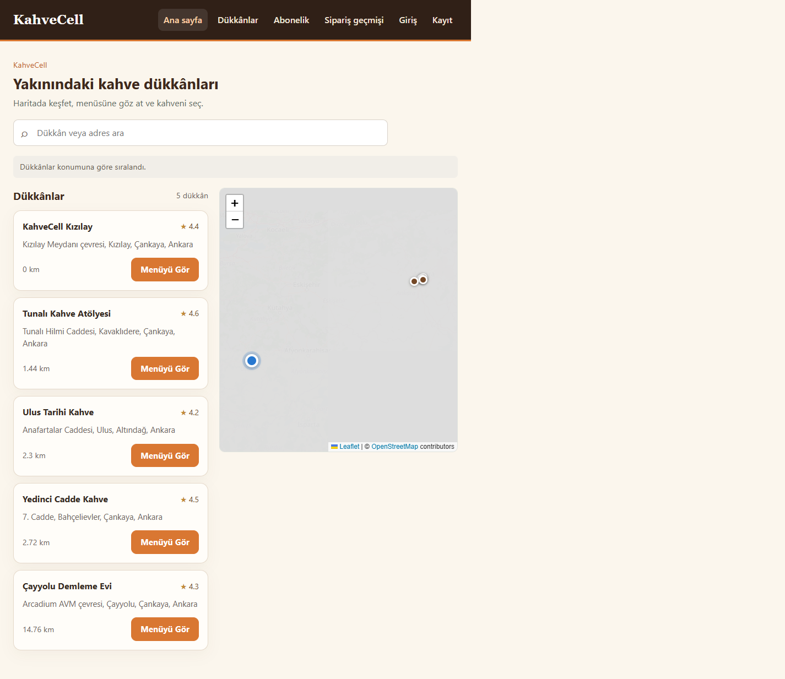
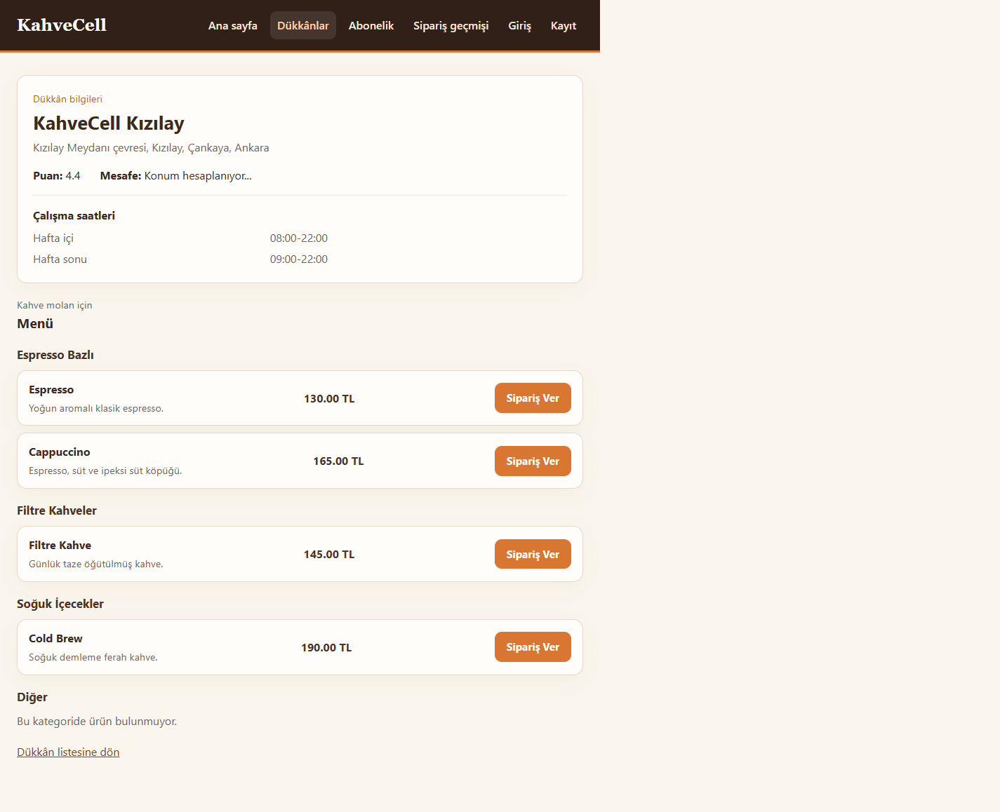
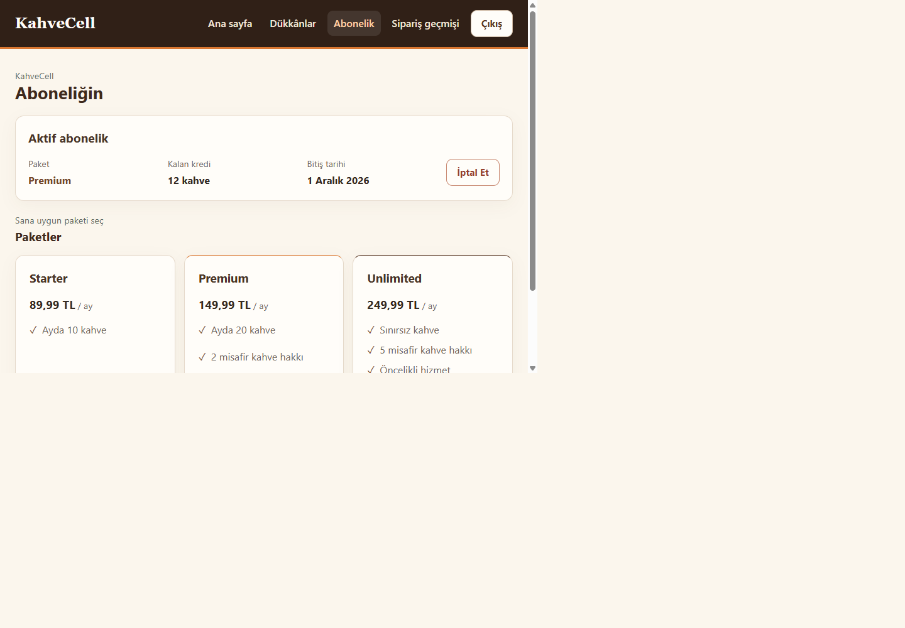
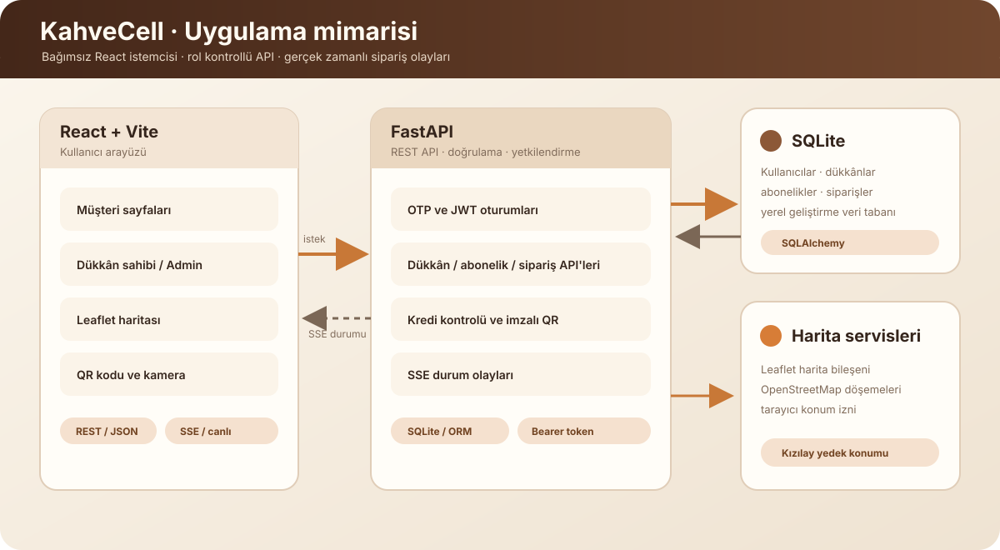
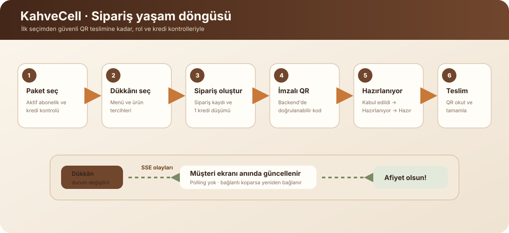

<div align="center">

# KahveCell

### Kahveni keşfet, aboneliğinle sipariş ver, QR kodunla teslim al.

**FastAPI · SQLite · React · Leaflet · Server-Sent Events**

</div>

KahveCell; kullanıcıların yakındaki kahve dükkânlarını bulabildiği, abonelik
kredileriyle sipariş verebildiği ve siparişini QR kodu üzerinden teslim aldığı
uçtan uca bir web uygulaması prototipidir. Proje, verilen ürün case'ini
çalışan bir müşteri, dükkân sahibi ve yönetici deneyimine dönüştürmek amacıyla
geliştirilmiştir.

> **Proje yaklaşımı:** KahveCell aynı zamanda bir prompt engineering
> projesidir. Ürün case'indeki ihtiyaçlar küçük ve doğrulanabilir parçalara
> ayrıldı; her özellik, yapay zekâ destekli kodlama oturumlarında açık
> gereksinimler ve kabul ölçütleriyle tarif edildi, uygulandı, test edildi ve
> gelen geri bildirimle iyileştirildi. Buradaki amaç yalnızca kod üretmek
> değil; doğru bağlamı kurmayı, kısıtları netleştirmeyi, sonuçları test etmeyi
> ve gerektiğinde istemleri yinelemeyi göstermektir.

## Görseller

### Uygulamadan ekranlar

Aşağıdaki ekran görüntüleri çalışan React arayüzünden alınmıştır; içerikler
tanıtım amacıyla kullanılan örnek verilerden oluşur.

| Ana sayfa ve harita | Dükkân menüsü | Abonelik |
| --- | --- | --- |
|  |  |  |

### Uygulama mimarisi



### Sipariş yaşam döngüsü



## Özellikler

### Müşteri deneyimi

- Telefon numarasıyla kayıt ve giriş; geliştirme ortamında OTP kodu `1234`
  olarak simüle edilir.
- Yakındaki dükkânları listeleme, ada/adrese göre arama ve mesafeye göre
  sıralama.
- Leaflet haritasında dükkân ve kullanıcı konumunu gösterme; konum izni
  verilmezse Ankara Kızılay koordinatlarını kullanma.
- Dükkân ayrıntılarını, çalışma saatlerini ve kategoriye ayrılmış menüyü
  görüntüleme.
- Boyut, süt, şeker ve ekstra shot tercihleriyle sipariş oluşturma.
- Abonelik paketlerini görüntüleme, test ödemesi yapma ve aboneliği iptal
  etme. Sipariş başına bir kredi düşer; sınırsız pakette kredi sayısı azalmaz.
- İmzalı QR kodla sipariş takibi ve sipariş geçmişi.
- QR ekranında sipariş durumunu **SSE ile gerçek zamanlı** alma; arayüz artık
  birkaç saniyede bir durum sorgulamaz.

### Dükkân sahibi deneyimi

- Yalnızca dükkân sahibi rolüne açık, müşteri ekranından ayrılmış sipariş
  paneli.
- Bekleyen, kabul edilen, hazırlanan ve hazır siparişleri ayrı sekmelerde
  takip etme.
- Sipariş durumunu **Kabul Edildi → Hazırlanıyor → Hazır** sırasıyla
  ilerletme.
- Hazır siparişi kamera üzerinden QR kodla doğrulayıp teslim etme.
- Sipariş listesini düzenli aralıklarla yenileme ve son başarılı yenileme
  zamanını gösterme.

### Yönetim paneli

- Dükkânları ve dükkân sahibi atamalarını yönetme.
- Siparişleri ve durumlarını inceleme.
- Abonelik ve ödeme kayıtlarını görüntüleme.
- Admin API'leri ve yönetim ekranı rol kontrolüyle korunur.

### Ortak arayüz ve hata durumları

- Uygulama genelinde kahve tonları, tutarlı buton/kart stili ve sağ üst toast
  bildirimleri.
- Veri yüklenirken gösterge; hata durumunda tekrar deneme; boş listelerde
  açıklayıcı ve yönlendirici mesaj.
- Harita altlıkları yüklenemediğinde ayrıca hata mesajı ve yeniden deneme
  seçeneği.

## Sipariş akışı ve gerçek zamanlı takip

1. Müşteri dükkânı ve ürünü seçer, abonelik kredisini kontrol ederek sipariş
   verir.
2. Backend siparişi kaydeder, uygun abonelik kredisini düşer ve imzalı QR
   içeriği üretir.
3. Dükkân sahibi siparişi kabul eder, hazırlama durumuna geçirir ve hazır
   olduğunda QR kodu okutur.
4. Her durum değişikliği veritabanı işlemi tamamlandıktan sonra müşterinin
   açık SSE bağlantısına gönderilir; teslimde QR yerine “Afiyet olsun”
   görünümü çıkar.

SSE bağlantısı Bearer token ile yetkilendirilir; token URL parametresi olarak
taşınmaz. Bağlantı koparsa QR ekranı yeniden bağlanmayı dener ve yeni
bağlantıda güncel sipariş durumunu alır. Mevcut olay dağıtıcısı tek backend
süreci içinde çalışır; birden fazla worker ile dağıtım yapılacaksa süreçler
arasında olay iletmek için Redis gibi ortak bir pub/sub altyapısı eklenmelidir.

## Teknoloji yığını

| Alan | Teknoloji |
| --- | --- |
| Backend API | Python, FastAPI |
| Veri tabanı ve ORM | SQLite, SQLAlchemy |
| Kimlik doğrulama | OTP simülasyonu, JWT access/refresh token |
| Gerçek zamanlı bildirim | SSE (Server-Sent Events) |
| QR güvenliği | İmzalı QR payload ve backend doğrulaması |
| Frontend | React 19, Vite, React Router |
| Harita | Leaflet, OpenStreetMap |
| QR kamera taraması | ZXing Browser |
| Testler | pytest, FastAPI TestClient |

## Proje yapısı

```text
KahveCell/
├── backend/
│   ├── app/
│   │   ├── api/v1/       # REST ve SSE uç noktaları
│   │   ├── core/         # Ayarlar, JWT ve kimlik doğrulama
│   │   ├── models/       # SQLAlchemy veri modelleri
│   │   ├── schemas/      # İstek/yanıt şemaları
│   │   └── services/     # QR, abonelik ve sipariş olay servisleri
│   ├── tests/            # API ve iş akışı testleri
│   ├── data/             # Yerel SQLite verisi (Git'e eklenmez)
│   ├── .env.example
│   └── requirements.txt
├── docs/
│   └── images/           # README şemaları ve gerçek arayüz ekran görüntüleri
├── frontend/
│   ├── src/
│   │   ├── api/          # Backend istemcisi
│   │   ├── components/   # Ortak layout, harita ve durum bileşenleri
│   │   └── pages/        # Müşteri, dükkân sahibi ve admin sayfaları
│   └── .env.example
└── README.md
```

## Yerel kurulum

### Gereksinimler

- Python 3.12 veya uyumlu güncel bir Python sürümü
- Node.js ve npm
- OpenStreetMap harita döşemeleri için internet bağlantısı

### 1. Backend

Önce `backend/.env.example` dosyasını `backend/.env` olarak kopyalayın.
`JWT_SECRET_KEY` değerini yerel geliştirme için rastgele bir değerle değiştirin.
Örneğin:

```powershell
py -c "import secrets; print(secrets.token_urlsafe(48))"
```

#### Windows PowerShell

```powershell
cd backend
py -m venv .venv
.\.venv\Scripts\Activate.ps1
pip install -r requirements.txt
Copy-Item .env.example .env
python seed_data.py
uvicorn app.main:app --reload
```

#### macOS / Linux

```bash
cd backend
python3 -m venv .venv
source .venv/bin/activate
pip install -r requirements.txt
cp .env.example .env
python seed_data.py
uvicorn app.main:app --reload
```

`seed_data.py` yerel geliştirme için Ankara'da örnek dükkânları, menüleri,
demo müşteri hesabını ve dükkân sahibi hesabını oluşturur/günceller. Seed
komutu test hesabı bilgilerini terminale yazar. Bu hesaplar ve OTP `1234`
yalnızca simülasyon içindir; gerçek kullanıcı bilgisi veya üretim parolası
kullanmayın. İlk çalıştırmada SQLite veri tabanı `backend/data/` altında
oluşturulur.

Backend çalışırken Swagger arayüzü:

```text
http://localhost:8000/docs
```

Admin panelini yerelde denemek isterseniz, `backend` klasöründe kayıtlı bir
kullanıcının rolünü değiştirebilirsiniz:

```powershell
$phone = Read-Host "Kayıtlı kullanıcının telefon numarası"
python set_user_role.py $phone ADMIN
```

Komut hesabı oluşturmaz; verilen numaranın daha önce kayıtlı olması gerekir.

### 2. Frontend

Backend açıkken yeni bir terminalde:

```powershell
cd frontend
npm install
npm run dev
```

macOS/Linux'ta da komutlar aynıdır. Vite'ın terminalde gösterdiği adresi
açın; varsayılan adres:

```text
http://localhost:5173
```

Backend adresini değiştirmek isterseniz `frontend/.env.example` dosyasını
`frontend/.env` olarak kopyalayıp `VITE_API_BASE_URL` değerini düzenleyin.

## Sayfalar

| Adres | Açıklama |
| --- | --- |
| `/` | Yakındaki dükkânlar, arama ve harita |
| `/register` | Telefon numarasıyla kayıt |
| `/login` | Telefon numarasıyla giriş |
| `/shops/:shopId` | Dükkân ayrıntısı ve menü |
| `/orders/new` | Ürün özelleştirme ve sipariş onayı |
| `/qr/:orderId` | QR kod ve SSE üzerinden canlı sipariş takibi |
| `/history` | Kullanıcının sipariş geçmişi |
| `/subscription` | Paketler, aktif abonelik ve ödeme simülasyonu |
| `/shop-owner` | Dükkân sahibinin sipariş kuyruğu ve QR taraması |
| `/admin` | Admin yönetim paneli |

## Uçtan uca demo senaryosu

1. Backend'i ve frontend'i çalıştırın; backend terminalinde `seed_data.py`
   tarafından yazdırılan test hesabı bilgilerini kullanın.
2. Müşteri hesabıyla giriş yapın. OTP ekranında simülasyon kodu `1234`'ü
   girin; abonelik satın alırken ödeme modalındaki test kartı numarası
   `4242-4242-4242-4242` olarak kullanılabilir.
3. Ankara haritasından bir dükkân ve menü ürünü seçip sipariş verin; QR takip
   sayfasını açık bırakın.
4. Seed komutunun oluşturduğu dükkân sahibi hesabıyla `/shop-owner` sayfasına
   girip siparişi kabul edin, hazırlamaya başlayın ve hazır durumuna getirin.
5. Müşteri ekranındaki durumun SSE üzerinden anında değiştiğini gözleyin;
   dükkân sahibi ekranında QR kodu okutunca sipariş teslim edilir ve müşteri
   ekranında “Afiyet olsun” mesajı görünür.

## Test ve kalite kontrolleri

Backend testlerini `backend` klasöründe çalıştırın:

```powershell
.\.venv\Scripts\python.exe -m pytest -q
```

Frontend kontrollerini `frontend` klasöründe çalıştırın:

```bash
npm run lint
npm run build
```

## GitHub'a yüklemeden önce

- `backend/.env` dosyasını ve gerçek sırları **asla** commit etmeyin.
- `backend/data/` içindeki SQLite veri tabanını ve kullanıcı verilerini
  repoya eklemeyin.
- `.gitignore` bu yerel dosyaları ve paylaşılan case dokümanını dışarıda
  tutar; commit öncesinde `git status` çıktısını kontrol edin.
- Ödeme ve OTP akışları demo simülasyonudur; gerçek ödeme/mesajlaşma servisi
  değildir.
- Üretim ortamı için güçlü secret yönetimi, HTTPS, gerçek SMS/ödeme
  sağlayıcısı, yedekleme ve çoklu-worker SSE pub/sub altyapısı ayrıca
  yapılandırılmalıdır.

## Prompt engineering çalışmasının kapsamı

Bu çalışma, tek bir büyük istemle kod üretmek yerine aşağıdaki yinelemeli
yaklaşımı kullandı:

1. Case gereksinimlerini kullanıcı, dükkân sahibi ve admin akışlarına ayırma.
2. Her akış için teknoloji, rol yetkisi, veri ve hata durumlarını netleştirme.
3. Backend API'lerini ve frontend sayfalarını küçük, birbirini doğrulayan
   adımlarla geliştirme.
4. Gerçek hata yanıtları ve tarayıcı davranışları üzerinden istemleri ve
   uygulamayı düzeltme.
5. Test, lint, build ve kullanıcı akışı kontrolleriyle sonucu doğrulama.

Bu nedenle repo, prompt engineering'i yalnızca istem yazımı olarak değil;
gereksinimi yapılandırma, yapay zekâya yeterli bağlam verme, çıktıyı eleştirel
değerlendirme ve çalışan yazılımı testlerle doğrulama süreci olarak ele alır.

---

Bu proje öğrenme ve portföy gösterimi amaçlıdır. Üretim kullanımı için
güvenlik, ödeme, gizlilik ve dağıtım gereksinimleri ayrıca gözden
geçirilmelidir.
